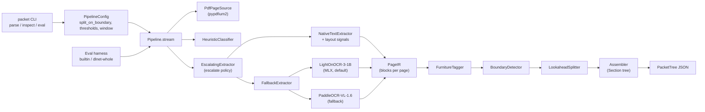
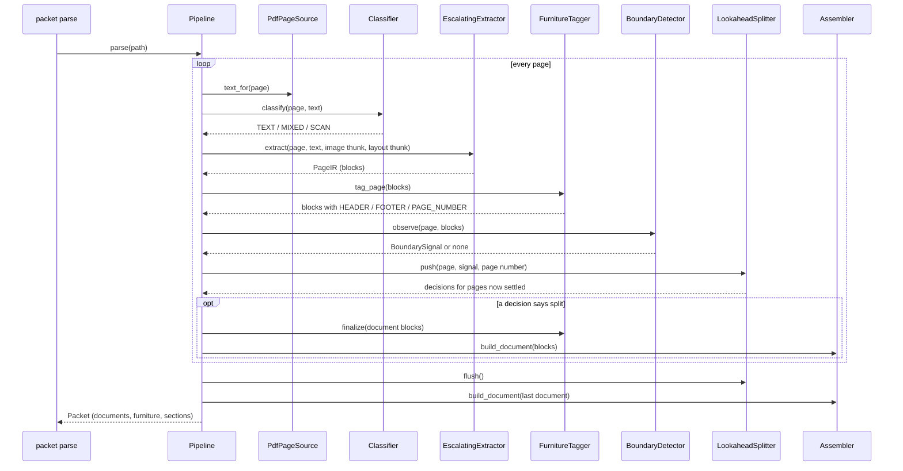
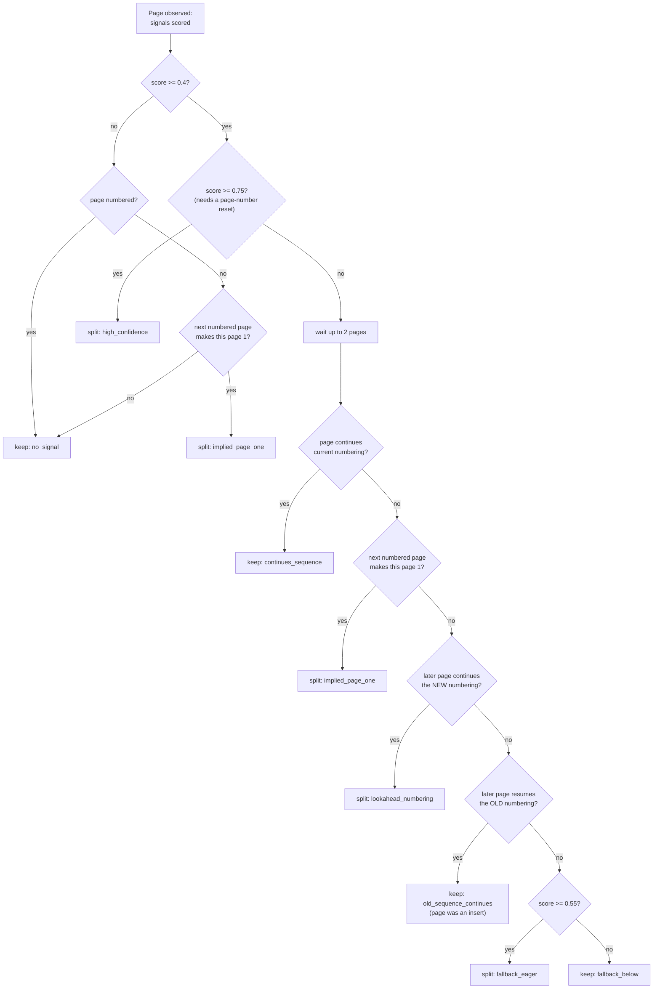

# Packet

Streaming document language understanding for files of unknown length.

Repo: [gman-robotics/packet](https://github.com/gman-robotics/packet)  
Name lock (2026-09-22): product **Packet**, package **packet-dl**, CLI **packet**.

**Not to be confused with:** "evidence-packet-protocol" is a separate,
unrelated agent-workflow skill name. This repository — product **Packet**,
package `packet-dl` — is a document language-understanding pipeline, not
an agent protocol. If a link brought you here looking for the protocol,
this is the wrong project.

A PDF (or a folder of page images) is a **packet**, not a document. Packet
classifies each page, extracts only what that page needs, detects logical
document boundaries as pages arrive, and assembles a semantic tree.

Domain extractors (legal, medical, financial, scientific) are adapters that
run *after* a `LogicalDocument` is closed. The core pipeline has no domain
vocabulary.

## Tree

```
Packet                         # one input file or scan batch
  LogicalDocument              # one work product inside the packet
    Section                    # heading-driven hierarchy
      Block                    # paragraph, table, figure, list, ...
```

Furniture (running headers, footers, page numbers) lives beside the body,
not inside it.

## Stream

Pages are the unit of I/O. Documents are the unit of meaning.

```
PageClassified
BlockEmitted
BoundaryProposed
DocumentOpened
SectionOpened / SectionClosed
DocumentClosed
PacketClosed
```

The tree is a materialized view over an append-only event log. Later pages
may reparent earlier blocks when heading levels or boundaries become clear.

## Pipeline

Packet reads a PDF one page at a time. For each page it decides how to read the
page, reads it into blocks, marks the furniture, and asks whether a new
document starts here. When it is sure, it closes the current document and
builds that document's section tree.

```
source        lazy page iterator: text, size and rendered image only on demand
classifier    TEXT | MIXED | SCAN | SUSPECT_ENCODING, from the text layer
backends      native text (+ layout) or OCR  ->  PageIR (the page's blocks)
furniture     HEADER / FOOTER / PAGE_NUMBER tagging from repeats across pages
boundary      weighted signals -> one proposal per page
splitter      look-ahead commit: split now, wait for page numbers, or keep
assembler     blocks -> heading-driven Section tree -> LogicalDocument
domain        optional adapters on DocumentClosed
```

Words used here:

- **PageIR**: the list of `Block`s for one page (text, kind, bbox, source,
  confidence). Every backend returns the same shape, so the later stages do
  not know or care which backend read the page.
- **Furniture**: running headers, footers and page numbers. They are kept
  beside the body, not inside it, and they are the main boundary evidence.
- **Text-layer page**: a page whose PDF has real, extractable text. Packet
  never OCRs such a page (design rule 1).

### Components



### One file, page by page



The image and layout arguments are thunks: functions that render the page or
read its character positions only if the chosen backend asks for them. A
text-layer page is never rendered.

### Reading a page

The escalate policy (`EscalatingExtractor`) picks the reader from the page class:

- **TEXT**: native text only. `NativeTextExtractor` reads pdfium characters
  with their font size, weight and position (`packet.layout`), and turns them
  into blocks the same way OCR pages get them:
  - the largest text in the top 45% of the page, at least 1.3x the body
    size, is a `TITLE`;
  - a short line that is bold or at least 1.12x the body size is a `HEADING`;
  - lines in the top or bottom 8% of the page height (the *bands*) become
    their own blocks at the start or end of the page, so furniture tagging
    can find them;
  - a labelled page number in a band (`Page 3`, `3 of 9`, `- 3 -`) is a
    `PAGE_NUMBER` at once. Bare numbers and running heads wait for evidence
    from other pages.
  - Rotated pages, or pages without character data, use the plain-text path.
- **SCAN, SUSPECT_ENCODING, MIXED**: OCR. LightOnOCR-3-1B (grounding mode, on
  MLX) runs first; PaddleOCR-VL-1.6 runs if LightOn cannot load or fails.
  A MIXED page whose OCR comes back empty keeps its thin text layer.
  `PACKET_OCR=off` turns OCR off; `--force-inspect` OCRs every page.

`FurnitureTagger` then looks at each page's first and last lines. A top line
is a `HEADER` when the same text, or the same small-type template (font size
and position), is the top line of another page within 3 pages. A bottom line
is a `FOOTER` when its text with digits ignored repeats the same way. A bare
number is a `PAGE_NUMBER` when it equals the page position or a neighbouring
page carries the number offset by the page distance.

## Splitting a packet into documents

`BoundaryDetector` scores each page against the page before it and proposes
"a new document starts here" with a confidence. The weights are in
`src/packet/boundary.py`:

| Signal | Weight | Fires when |
|---|---|---|
| `page_number_reset` | 0.45 | the page is number 1 and the previous page was above 1 |
| `sequence_completed` | +0.2 | with a reset: the previous page was "N of N" |
| `header_changed` | 0.25 | the previous page had a tagged running head and this page's head differs |
| `media_box_changed` | 0.2 | the page size or rotation jumps |
| `title_top` | 0.45 | the first body block on the page is a `TITLE` |
| `title_block` | 0.25 | a `TITLE` lower on the page |

How the scores combine:

- A signal of **0.4** or more is proposed (`PROPOSE`).
- **Weak-signal combining**: two or more *independent* signals together are
  lifted to at least **0.6** (`COMBINED`). `sequence_completed` and
  `title_block` do not count as independent: the first only refines a reset,
  and the second is too common inside documents.
- Without a page-number reset the score is capped at **0.74**
  (`CAP_WITHOUT_RESET`), just under the commit level, so page numbers on the
  next pages can still veto the split.
- `header_changed` is not counted when the head keeps its template (same
  font size and position) and only its text changes, for example chapter
  titles in a running head. It is also not counted on a chapter opener
  page (title at the top, same page size) that drops a small running head.

`LookaheadSplitter` then decides. A proposal of **0.75** or more
(`boundary_commit_confidence`) splits at once. A weaker one waits up to
**2** pages (`lookahead_window`) for page-number evidence: new numbering
that continues means split, old numbering that resumes means the page was
an insert. With no evidence, it splits at **0.55** or more
(`boundary_min_confidence`). An unnumbered page with no signal still splits
when the next numbered page puts it at page 1 of a new sequence
(`implied_page_one`). `PipelineConfig(lookahead_window=0)` restores eager
commit (split at 0.55 or more), and `--no-split` keeps one document.



The remaining fail modes are in `DESIGN.md` → Boundary policy.

## Status

Working today: the schema and event contract, the page source, the heuristic
classifier, native text with layout signals, LightOn and Paddle OCR (weights
download on first use; LightOn needs Apple silicon), furniture tagging,
boundary splitting with look-ahead (on by default), the section assembler,
and two eval sets (`packet eval` and `packet eval --set dlnet-whole`).
Docling and pdf-inspector adapters are still stubs.

## Install

```bash
pip install -e ".[dev]"
packet inspect path/to/file.pdf
packet parse  path/to/file.pdf -o packet.json
packet eval                        # built-in fixtures (boundary P/R, false-OCR gate)
packet eval --set dlnet-whole      # 13 packets from 35 whole arXiv PDFs (downloads once)
pytest
```

See [`docs/EVAL.md`](docs/EVAL.md) and [`evals/README.md`](evals/README.md)
for what `packet eval` checks, the dlnet-whole set, and how to point it at DocLayNet.

## Design rules

1. Never OCR a page with a trustworthy text layer.
2. Every node carries page, bbox when known, source, and confidence.
3. Core types stay domain-agnostic.
4. A slow or missing backend is not a reason to change the tree schema.
