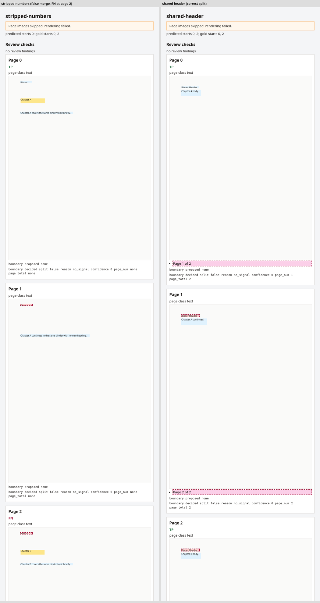

# Packet v0 eval definitions

Status: **live harness, partial metric coverage.** A runnable harness
exists at `src/packet/eval/` (`fixtures.py`, `metrics.py`, `run.py`,
`pdfutil.py`, `doclaynet.py`), is exercised by `tests/test_eval_fixtures.py`
and `tests/test_eval_metrics.py`, and is wired to the CLI as `packet eval`
/ `packet eval-plan` (`src/packet/cli.py`; see `evals/README.md` for
command examples). This file is still the fuller spec — not every metric
named below is implemented yet, and the definitions here are what a metric
must mean *when* it lands, not just what it meant when this was plan-only.
See `DESIGN.md` → Eval (generic) for the one-line summary this file
expands on.

**What `packet eval` computes today**, against the four built-in fixtures
below: **§1 Boundary P/R/F1** and the **§5 False-OCR hard-fail gate**.
Those are the two things the gate checks: `packet eval` exits 1 when any
fixture's boundary F1 (tolerance 0) is below `--min-f1` (default 1.0), when
the macro-average F1 is below `--min-macro-f1` (default: `--min-f1` for the
builtin set; 0.6 for `dlnet-whole` whatever `--min-f1` is), or on
any false-OCR hard-fail page (`packet.eval.run.evaluate_gate`). The
false-OCR check uses each page's real text layer (>= 40 chars), not the
fixture's condition label. `citation_integrity` (§4) is implemented as a library function in
`packet.eval.metrics` but nothing calls it from `run.py` or the CLI yet —
treat it as available, not wired in. **Heading-path accuracy (§2)** and
**reading-order quality (§3)** have no implementation at all yet (no
function in `packet.eval.metrics`); both sections below are spec only
until that lands.

**`packet eval --set dlnet-whole`** (GMA-216) scores the same §1 boundary
metric on a second, larger set. It downloads 35 whole arXiv papers named by
DocLayNet (about 20 MB, sha256-pinned, cached in `~/.cache/packet/dlnet-whole`
or `--data-dir`) and joins them into 13 packets with a seeded plan
(`evals/README.md`, `src/packet/eval/wholedoc.py`). Nothing third-party is
committed. The gate floors come from `SET_FLOORS` in `src/packet/eval/run.py`:
macro F1 >= 0.6 and no per-packet floor (0.0), plus the false-OCR gate.

It is a friendly set: one category (scientific articles), printed page
numbers, and mixed A4/Letter sizes that give `media_box_changed` for free.
Treat it as a smoke test for splitting, not as a measure of real mixed
packets. Report micro recall and precision over its 22 gold boundaries next
to the macro F1, because one packet with a miss moves the macro number a lot.

**`packet eval --set politax`** (GMA-270) scores boundary F1 on all 30
PoliTax-Split PDFs (Extend-AI/PoliTax-Split on Hugging Face). Each whole PDF
is one fixture; gold sub-documents come from the pinned CC0
``annotations.jsonl``. Downloads land in ``~/.cache/packet/politax`` or
``--data-dir``; nothing third-party is committed. Plain-run floors are
report-only (0.0 per fixture and macro); ``--ocr-cache`` runs are gated (Q7 below). The CLI prints macro F1, micro boundary P/R/F1,
gold label totals (boundaries and sub-documents), a text-layer census (pages with at least 40 native characters),
and the holdout heuristic baseline (including the Q7 note that the native-text run yields **0 predicted boundaries**
on holdout scan-only PDFs, baseline macro F1 0.00).

**PoliTax train/holdout** (GMA-274): train = ``trump`` whole PDFs; holdout =
``obama``, ``harris``, and ``biden`` whole PDFs (frozen in
``packet.eval.politax_split``). ``packet eval --set politax`` prints the
holdout heuristic baseline (macro and micro boundary F1) and a **proposed**
macro floor (heuristic holdout macro truncated to two decimals). Q7 is locked
(Tom, 2026-10-24): ``packet eval --set politax --ocr-cache`` gates the holdout
macro F1 at **0.41** and every fixture at 0.0 (``OCR_CACHE_FLOORS`` in
``src/packet/eval/run.py``; measured holdout macro 0.4159). Plain
``packet eval --set politax`` stays report-only at 0.0/0.0. Explicit
``--min-f1``/``--min-macro-f1`` flags still override.

**What the eval pipeline runs.** `packet eval` uses `Pipeline()` with its
default extractor, `NativeTextExtractor`, so it reads text layers (with the
layout signals: titles, headings and band lines from font size, weight and
position) and never OCRs (plain run). OCR quality and live OCR-page splitting are
measured outside `packet eval`, on real mixed packets run through `packet parse`;
the one exception is the opt-in ``--set politax --ocr-cache`` gate, which reads
cached OCR text (no OCR runs).

All metrics are computed per-packet and then aggregated (macro-average
across packets, not micro-average across pages) unless stated otherwise.
Always report results sliced by page condition — `born-digital`,
`clean-scan`, `dirty-scan`, `handwriting` — in addition to the pooled
number, because a single pooled score hides regressions that only show up
on scans. (Today's built-in fixtures only cover `born-digital` and
`clean-scan` — see the fixture pack below.)

## 1. Boundary P/R — how a boundary match is scored

A "boundary" is the page index *after which* a new `LogicalDocument`
starts. For an N-page packet, both the gold set and the predicted set are
subsets of `{0, 1, ..., N-2}` (a boundary cannot occur after the last
page).

- **Predicted boundaries**: derive from `packet.documents` — for each
  document except the last (in page order), its `page_end` is a predicted
  boundary.
- **Gold boundaries**: the corresponding `page_end` values from the
  hand-labeled fixture's document list.
- **Match rule**: a predicted boundary at page `p` matches a gold boundary
  at page `g` iff `abs(p - g) <= tolerance`, with **`tolerance = 0`** as
  the default/reported number (exact page match). Report `tolerance = 1`
  as a secondary, more forgiving number, but `tolerance = 0` is the
  number that gates a build.
- Each gold boundary may be matched by at most one predicted boundary and
  vice versa (compute via greedy nearest-match when `tolerance > 0`, which
  is only ever ties at `tolerance = 0`).
- **Precision** = matched predicted boundaries / total predicted
  boundaries.
- **Recall** = matched gold boundaries / total gold boundaries.
- **Boundary F1** = harmonic mean of the two above. This is what
  `DESIGN.md` calls "Packet F1 — logical document page ranges": it is
  scored via boundary matches, not via a set-overlap metric over page
  ranges, because boundary matching is simpler to define exactly and page
  ranges are fully determined by the sorted boundary set plus 0/N-1.
- **Edge case — zero boundaries either side**: if a packet is truly one
  document (gold has zero boundaries) and the prediction also has zero,
  that packet scores P=1.0, R=1.0 for that packet and is excluded from the
  denominator only if *both* sides are empty; if one side is empty and the
  other is not, it scores normally (P=0 or R=0 as appropriate).

## 2. Heading-path accuracy

For every `Section` in the gold tree that has a non-null `heading`, define
its **heading path** as the ordered list of `heading` strings from the
root section down to and including itself (e.g. `["1. Overview", "1.1
Markets"]`).

- Build the same heading path for the predicted tree's sections.
- Align gold and predicted sections by **page overlap**: a predicted
  section matches a gold section if they share at least one page and both
  have the same `heading` text (case-insensitive, whitespace-normalized)
  at that tree depth.
- **Heading-path accuracy** = (count of matched sections whose full
  heading path is identical to the gold path) / (count of gold sections
  with a non-null heading).
- A section that exists in gold but has no page-overlapping predicted
  counterpart counts as a miss (0), not an exclusion.

## 3. Reading-order quality

Restricted to blocks within a single matched section (see #2 for the
match rule).

- Take the gold blocks' order within that section (their index in
  `Section.blocks`, which encodes intended reading order — this matters
  most for multi-column pages and lists that a naive top-to-bottom sort
  would interleave incorrectly).
- Take the predicted blocks in the same section, restricted to blocks
  whose `id` also exists in gold (ignore extra/missing blocks here; that
  is a different failure mode, covered by boundary/assembly metrics).
- Compute **Kendall's tau** between the gold order and the predicted order
  of that shared block-id set.
- **Reading-order quality** = mean Kendall's tau across all matched
  sections that have 2+ shared blocks (sections with 0-1 blocks are
  excluded — no ordering question to ask).

## 4. Citation integrity

For every `LogicalDocument` in the *predicted* output:

- For every key/value pair in `doc.extras` (and recursively in any
  `Section.extras` a domain adapter may have added), if the value is
  meant to cite a `Block` (by the adapter's own contract — adapters must
  declare which `extras` keys are block-id citations), resolve it against
  the document's own `sections[*].blocks[*].id` and `furniture[*].id`.
- **Citation integrity** = (citations that resolve to a real block id in
  the same document) / (total citations emitted).
- A citation to a block id from a *different* `LogicalDocument`, or to no
  block at all, is a failure, not a warning — this metric exists
  specifically to catch domain adapters that silently point at stale or
  cross-document block ids after a boundary commit.

## 5. False-OCR hard-fail (gate, not a scored metric)

This is a binary pass/fail check, not something you average. It directly
tests `DESIGN.md`'s design rule #1 ("never OCR a page with a trustworthy
text layer").

**Condition:** for any page in any fixture, if that page's `PageRef` has
`has_text_ops=True` **and** a native text sample of at least
`HeuristicClassifier.min_chars` (40) characters, but the block(s) emitted
for that page have `source in {SourceKind.OCR, SourceKind.VLM}`, that page
is a **false-OCR hard-fail**.

- **Gate rule:** any single false-OCR hard-fail on any fixture fails the
  whole eval run. This is intentionally not a rate/threshold — the design
  rule it enforces is absolute, not statistical.
- Inside `packet eval` this gate is easy to pass, because the eval
  pipeline uses only `NativeTextExtractor` (see "What the eval pipeline
  runs" above): every emitted block has `source=SourceKind.NATIVE`, or the
  page is empty (the `SCAN` fail-closed case). The OCR backends
  (LightOnOCR-3-1B first, PaddleOCR-VL-1.6 as fallback) run in
  `packet parse` and `packet inspect` through `EscalatingExtractor`, which
  sends only SCAN, MIXED and SUSPECT_ENCODING pages to OCR. The gate stays
  here so that an eval run with OCR enabled is checked by the same rule.

## Named fixture pack

Each fixture is a small PDF (a few pages, so gold labeling stays cheap)
plus a hand-authored gold `Packet` — at minimum `document_count` and each
document's `page_start`/`page_end`. In v0 these are not static files
checked into git: `packet.eval.fixtures.build_builtin()` generates the
four PDFs below on the fly (via `packet.eval.pdfutil`) and pairs each with
its gold `Packet` in code, so the fixture *and* its label stay in sync by
construction. `packet eval` writes the generated PDFs to
`.packet-eval/builtin/` by default (override with `--dir`; see
`evals/README.md`) — that directory is generated
output, not a fixture source, and is gitignored.

1. **`text-layer`** — single born-digital document, 3-5 pages, consistent
   header/footer, no scanned pages. Control case: gold has **zero**
   boundaries. Exercises the "no false split" side of boundary P/R and is
   the baseline for reading-order and heading-path accuracy on clean
   input.
2. **`multi-doc`** — 2-3 born-digital documents concatenated into one
   PDF, each with its own page numbering restarting at 1 and a distinct
   header. This is the easy positive case for boundary detection (clear
   `page_number_reset` signal) and exercises heading-path accuracy across
   a document boundary (make sure section trees do not bleed across
   `_close_document` calls).
3. **`shared-header`** — 2 documents concatenated where both share the
   *same* header/footer template (e.g. two chapters of the same report
   exported separately, or a template-generated form) but each restarts
   page numbering. This names the accepted false-merge fail mode from
   `DESIGN.md` → Boundary policy: if the header/footer signal genuinely
   compared header/footer text, it would not fire here (the header is
   identical), and recovery would depend on `page_number_reset` alone —
   which, at its solo score of `0.45`, sits *below*
   `boundary_min_confidence` (`0.55`), so this fixture is designed to be
   the hardest one for boundary recall. (With look-ahead commit a 0.45
   reset can still split when the following page continues the new
   numbering, so recall here no longer depends on the header signal.)
   Since the layout signals (GMA-217), this fixture tests what it claims.
   `FurnitureTagger` tags the shared top line as a `HEADER` on every page
   and the `Page N of M` lines as `PAGE_NUMBER`, so `header_changed` does
   not fire: the header text is the same on both sides of the boundary.
   The split comes from page numbers only: `page_number_reset` (0.45) plus
   `sequence_completed` (+0.2) gives 0.65. That is below the 0.75 commit
   level, so the look-ahead splitter waits, sees page 2 of the new
   numbering on the next page, and splits (`lookahead_numbering`). Track
   this fixture's boundary recall separately; do not let it get averaged
   away by `multi-doc`.
4. **`scan`** — pages with no extractable text layer at all
   (`has_text_ops=False`), no OCR ground truth needed for text content;
   the assertion this fixture drives is behavioral, not textual: under
   the eval pipeline's native-only `Router`, every page must classify
   `SCAN` and every page's `Router.extract()` call must return `[]`. This fixture is the
   regression test for the fail-closed behavior in `DESIGN.md` →
   Escalation policy, and it doubles as a trivial pass for the
   false-OCR hard-fail gate (there is nothing to mis-route to OCR yet).

Next: add `dirty-scan` and `handwriting` variants of `scan` that run with
OCR enabled. The OCR backends exist now, so these fixtures would have
output to score.

## PoliTax OCR cache (optional; GMA-275; `--ocr-cache` gate holdout macro 0.41)

`packet politax-ocr` writes raw LightOnOCR-3-1B grounding text (MLX, Apple silicon,
`pip install -e '.[ocr-mlx]'`) for every PoliTax page whose stripped native text is
under 40 characters (the section 5 / census threshold). Layout, beside the PDFs:

    <data-dir>/ocr/<pdf_sha256>/p00000.json   # 0-based page; sha256 from the manifest pin
    <data-dir>/ocr/_runs/<utc>-<pid>.json     # one log per invocation

- Resumable and idempotent per page: atomic temp+fsync+rename writes; a rerun skips any
  record whose engine id (model, revision, mode, max_tokens, render_px) matches. A change
  to any of those redoes the page. Truncated generations are recorded, not redone.
- `--dry-run` fetches (sha256-checked) and prints selected/cached/pending counts without
  loading a model. `--report` prints page count, engine and summed wall time for the PR.
- `--data-dir` inside the repo exits 2. Nothing is committed.
- The default `packet eval` (every set) and CI never read this cache or import OCR
  extras; `tests/test_politax_ocr_guard.py` enforces that in a no-extras subprocess.
  The only reader is the opt-in `packet eval --set politax --ocr-cache` (GMA-274),
  which reads cached text and still loads no OCR engine.

### Loop early-stop

`packet politax-ocr --loop-stop` is on by default (`--no-loop-stop` drains each page).
LightOn watches the stream and stops when the last 1,500 characters compress with
zlib level 9 to a ratio under 0.02. The rule is not part of `EngineId`, so records
already in the cache stay current. A page that stops early is stored with
`stop=loop` and `truncated=false`. `truncated` still means the token count reached
`max_tokens`.

Read-only check (does not write the cache and does not load MLX):

    python scripts/replay_ocr_loop_stop.py
    python scripts/replay_ocr_loop_stop.py --data-dir ~/.cache/packet/politax/ocr

## HTML reports (`--viz-dir`)

`packet eval --viz-dir DIR` writes one HTML report per fixture, plus reports for
the known fail modes. Fail-mode reports always use the default pipeline, even
with `--boundary-weights`. The screenshot shows `stripped-numbers` (a false
merge: page 2 is marked FN) next to `shared-header` (page 2 is a correct TP).

